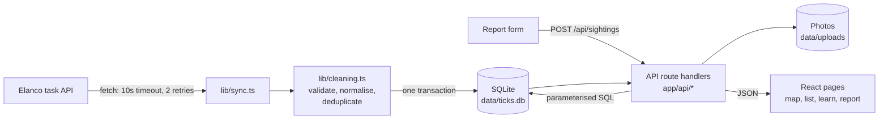

# TickTrack UK

A full-stack web app for exploring and reporting tick sightings across 14 UK cities, built for the Elanco Software Engineer placement technical task (Full Stack version).

It takes the sighting data from Elanco's task API, cleans and stores it, serves it through its own API with filtering and aggregate statistics, and presents it as an interactive map, city details, educational content and a form for reporting new sightings.

**Author:** Kartik · [github.com/krtk119](https://github.com/krtk119)
**Walkthrough video:** _link to be added_

---

## Contents

- [Running it](#running-it)
- [What it does](#what-it-does)
- [How it meets the brief](#how-it-meets-the-brief)
- [Architecture](#architecture)
- [How the data is consumed and processed](#how-the-data-is-consumed-and-processed)
- [How the data is presented](#how-the-data-is-presented)
- [API reference](#api-reference)
- [Technical choices](#technical-choices)
- [What I found in the data](#what-i-found-in-the-data)
- [Testing and quality](#testing-and-quality)
- [Accessibility](#accessibility)
- [Privacy, safety and honesty](#privacy-safety-and-honesty)
- [How I used AI tools](#how-i-used-ai-tools)
- [An AI feature I'd add next: Ask TickTrack](#an-ai-feature-id-add-next-ask-ticktrack)
- [Limitations and what I'd improve](#limitations-and-what-id-improve)
- [Project structure](#project-structure)

---

## Running it

You need **Node.js 22.13 or newer** (developed and tested on Node 24) and an internet connection, because the app downloads the sighting data from the Elanco API the first time it runs. No database server, API key or account is needed.

```bash
git clone https://github.com/krtk119/ticktrack-uk.git
cd ticktrack-uk
npm install
npm run dev
```

Then open **http://localhost:3000**.

The first page load takes a few seconds while the app fetches and cleans the Elanco data and stores it in a local SQLite file (`data/ticks.db`, created automatically).

| Command | What it does |
|---|---|
| `npm run dev` | Development server with hot reload |
| `npm run build` then `npm start` | Production build and server |
| `npm test` | Runs the 58 automated tests |
| `npm run lint` | Runs ESLint |

### Why it runs locally rather than at a live link

The brief asks for a public repo with clear instructions on how to run it, and doesn't ask for a deployment. I chose to make running it locally as simple as possible rather than host it:

- **It needs no setup beyond `npm install`.** The database is a SQLite file the app creates itself, so there's no database server, account or API key to configure.
- **The common free hosts wouldn't work as-is.** Platforms like Vercel run each request in a temporary environment where files written to disk don't last, so the SQLite database and uploaded photos would be lost. Deploying properly means moving to a hosted database and file storage, which I describe under [Limitations and what I'd improve](#limitations-and-what-id-improve).
- **A reviewer gets the full app, not a demo.** Running it locally, you can submit reports, upload photos and run the tests yourself.

### Troubleshooting

- **"TickTrack UK needs Node.js 22.13 or newer"**: the database is built into Node.js, so older versions can't run the app. Check with `node -v` and upgrade from [nodejs.org](https://nodejs.org). If you use nvm, `nvm use` picks up the version in `.nvmrc`.
- **"Upstream Elanco API is unavailable"** on first run: the app couldn't reach `dev-task.elancoapps.com` (no internet, or a firewall or proxy blocking it), and has no saved data yet. Once it has synced once, it keeps working offline from the saved copy.
- **Map markers show but the map background is grey**: map tiles come from OpenStreetMap; a network that blocks it will hide the background but not the data.
- **Port 3000 already in use**: Next.js will offer another port (such as 3001); use the address it prints.

**If `npm install` warns that install scripts were blocked** (some npm versions do this), approve the image library and rebuild it:

```bash
npm approve-scripts sharp
npm rebuild sharp
```

---

## What it does

**Map** (`/`)
- A UK map with one marker per city, sized by number of sightings and coloured by the most commonly reported species
- Filters for date range, species and data source (Elanco dataset or community reports), kept in the URL so any view can be shared or bookmarked
- A **city panel** when you select a marker: total sightings, a breakdown by species, a timeline (by year or by month), the 20 most recent sightings, and **Get directions** / **Share** buttons
- A **list view**: the same filtered data as an accessible, paged table, as an alternative to the map

**Learn** (`/learn`)
- A guide to the five species in the dataset, with live figures for each (sightings, city most reported in, busiest month)
- A seasonal activity chart for all cities or one city
- Advice on preventing tick bites, removing a tick, and what to do if your pet has one, summarised from NHS and UKHSA guidance with links to the sources

**Report a sighting** (`/report`)
- A form for date, city, species, notes and an optional photo
- Instant validation in the browser plus the server's own field-level errors, with a clear error summary, warnings and a success message
- Photos have their location data (EXIF/GPS) removed before they are stored
- A warning (not a rejection) if a very similar sighting already exists
- New reports appear on the map straight away, labelled as unverified community reports

---

## How it meets the brief

### Backend

| Requirement | How it's met |
|---|---|
| Plan for consuming and processing the API data | Fetch with timeout and retries → validate → clean → store in SQLite → refresh hourly. See [How the data is consumed and processed](#how-the-data-is-consumed-and-processed) |
| Large datasets | Data is stored and indexed locally rather than re-downloaded per request; `/api/sightings` is paged (`limit`/`offset`); counts and statistics are calculated in SQL, so the browser never downloads the full dataset |
| Duplicates | Removed by ID and by identical date + city + species, and counted |
| Incomplete data | Records with missing or invalid fields are rejected, each with a counted reason |
| Endpoint for new reports | `POST /api/sightings` |
| Search and filter by time and location | `from`, `to`, `city`, `species` and `source` filters on every read endpoint |
| Aggregate insights | Sightings per region, trends by week or month, seasonal activity, per-species summary |
| Error handling | Upstream failures (retry, then serve saved data marked as stale, or a clear 503 if there is none), data inconsistencies (cleaning report), invalid submissions (400 with field-level errors) |

### Frontend (at least 2 from each area)

| Area | Built |
|---|---|
| Interactive map | Dynamic UK map ✓ · Markers sized and coloured by activity and species ✓ · Filter controls ✓ |
| Sighting information | Side panel with details ✓ · Timeline of activity in the selected city ✓ · Get directions and Share ✓ |
| Educational content | Species guide ✓ · Prevention tips ✓ · Seasonal activity chart ✓ |
| Report a sighting | Form ✓ · Validation with error, warning and success messages ✓ · Image upload ✓ |

### Optional extras

- **Documentation:** this README
- **Wireframes:** see [`docs/wireframes`](docs/wireframes)
- **Accessibility:** see [Accessibility](#accessibility)

---

## Architecture



It is a single **Next.js** project. The **backend** is a set of route handlers under `app/api`, which read and write a local **SQLite** database. The **frontend** is React pages under `app`, which only ever call the app's own API, never the Elanco API directly. That keeps the cleaning in one place and means the frontend keeps working if Elanco's API is down.

---

## How the data is consumed and processed

1. **Fetch** (`lib/sync.ts`). On the first request, or when the stored data is over an hour old, the server fetches `/tick-sightings` and `/stats` from the Elanco API, with a 10-second timeout and up to 2 retries. If `total_sightings` from `/stats` doesn't match the number of records received, it logs a warning, so I'd notice if the API ever started paginating.
2. **Clean** (`lib/cleaning.ts`). Every record is checked against a Zod schema and then normalised. Each record is either kept or rejected with one specific reason, and the reasons are counted:
   - missing or empty required fields
   - unparseable dates, or impossible ones such as 31 February (JavaScript would silently turn that into 3 March)
   - dates in the future
   - a city outside the 14 supported cities, or an unknown species (logged as a warning)
   - duplicates, by ID or by identical date + city + species
   - Latin names that don't match the species are corrected to the known name and counted, not rejected
3. **Store.** The cleaned records replace the previous Elanco records in a single database transaction, so the app never shows a half-updated dataset, and records removed upstream disappear. Community reports are never touched by the sync.
4. **Serve.** Every read endpoint validates its query parameters and uses parameterised SQL. If a refresh fails but saved data exists, responses carry `"stale": true` and the UI shows a banner saying the live data source is unavailable.

**Dates:** the API's timestamps have no timezone (for example `2022-08-01T06:40:31`). JavaScript would read these in the server's local time, so the same data would give different results on a UK laptop and a UTC server, and sightings near midnight could move to a different day. The cleaning step reads them explicitly as UTC, and the tests run in the `Europe/London` timezone to prove it.

---

## How the data is presented

- **One source of truth for filters.** The map, city panel and list view all use the same four filters, held in the URL. So the numbers in a city's panel always match its marker, and a shared link reopens exactly the same view.
- **Summaries before detail.** The map shows one marker per city; selecting it shows the species breakdown and timeline; only then the individual sightings. The browser downloads only what's on screen (one page of the list, 20 recent sightings, or pre-calculated counts), never the whole dataset.
- **Charts that suit the data.** The city timeline defaults to yearly totals, because monthly bars at about half a sighting per month would be mostly empty. Gaps are filled with zeros so charts never skip periods.
- **Every state is handled.** Each view has a loading state, an error state with a retry button, and an empty state that suggests what to change. If the Elanco API is down, a banner explains that saved data is being shown.
- **Where the data came from is always visible.** Each record is labelled "Elanco dataset" or "Community · unverified".

---

## API reference

All errors use the same shape: `{ "error": { "code", "message", "details"? } }`, with no stack traces.

| Endpoint | Description |
|---|---|
| `GET /api/sightings` | Sightings, newest first. Filters: `from`, `to` (YYYY-MM-DD), `city`, `species`, `source` (`elanco` / `community`). Paging: `limit` (default 100, max 500), `offset`. Returns `{ sightings, total, limit, offset, stale }` |
| `GET /api/sightings/{id}` | One sighting, or 404 |
| `POST /api/sightings` | New community report (multipart form): `date`, `city`, `species`, optional `notes` (≤500 characters) and `image` (JPEG/PNG/WebP, ≤5 MB). Returns 201 with the record and `possibleDuplicate`, or 400 with field-level errors |
| `GET /api/stats/regions` | Sightings per city with coordinates and most common species. Filters: `from`, `to`, `species`, `source` |
| `GET /api/stats/trends` | Counts by `interval=week` or `month`, with empty periods filled with zero. Filters: `from`, `to`, `city`, `species`, `source` |
| `GET /api/stats/seasonal` | Counts by month of the year (Jan to Dec). Filter: `city` |
| `GET /api/stats/species` | Per species: count, city with most sightings, busiest month. Filters: `from`, `to`, `city`, `source` |
| `GET /api/uploads/{name}` | A stored photo |
| `GET /api/health` | Database status and whether the Elanco API is reachable |

Unknown cities or species return 400 with a list of valid values, rather than an empty result, so a typo can't look like "no ticks here".

---

## Technical choices

| Choice | Why |
|---|---|
| **Next.js (App Router), React, TypeScript, Tailwind CSS** | One project for both frontend and backend, strict typing across both, and it matches the web stack Elanco described in its placement presentation |
| **SQLite, built into Node.js** (`node:sqlite`) | Real persistence with zero setup: nothing to install, download or compile. I first used the better-sqlite3 package, but a fresh-clone test showed it needed C++ build tools to install on Windows, so I switched to Node's built-in driver. The schema is plain SQL, so moving to MySQL or Postgres for a multi-user deployment is a small change |
| **Zod** | Validates everything coming in, from the Elanco API, query strings and the report form, at runtime, not just at compile time |
| **Leaflet with OpenStreetMap** | Free, open and needs no API key, so the app runs for anyone without signing up for a maps service |
| **Recharts** | Simple, declarative charts that fit React |
| **sharp** | Re-encodes uploaded photos, which removes all metadata including GPS location |
| **Vitest** | Fast tests that run the real route handlers against an in-memory database |
| **GitHub Actions** | Runs lint, tests and a production build on every push |

**One marker per city, not one dot per sighting.** The data only says "Manchester", not where in Manchester. Scattering 1,000 dots around each city would invent a precision the data doesn't have.

---

## What I found in the data

- **The current data is clean.** All 1,000 records have every field, with no duplicate IDs and no invalid dates. The cleaning pipeline still handles all of those cases, because the brief asks for it and real data changes. The tests cover each one.
- **Locations are city names only** (14 cities), with no coordinates. City coordinates come from a small lookup table in `lib/cities.ts`.
- **The data is sparse.** 1,000 sightings across 14 cities over 13 years (2012 to 2024) is about **0.5 sightings per city per month**. That's why the city timeline defaults to a yearly view, and why I decided **not** to build anomaly detection: baselines that small would flag random noise as "spikes".
- **No strong seasonal pattern.** Sightings are spread fairly evenly across the year (66 in May up to 100 in December). Real UK tick activity, according to UKHSA, peaks in spring and early summer. The seasonal chart says this rather than implying the data shows real seasonality.
- **A naming question.** The data gives the passerine tick's Latin name as *Dermacentor frontalis*; it is more commonly listed as *Ixodes frontalis*. I display the source's value and flag it, rather than silently changing someone else's data.
- **A missing species.** *Ixodes ricinus* (the sheep or deer tick), the tick people and pets in the UK most often encounter, isn't in the dataset. The Learn page says so.

---

## Testing and quality

- **58 automated tests** (`npm test`) covering the cleaning rules, UTC date handling, sync and caching (including the Elanco API being down, with and without saved data), every endpoint, filters, paging, validation errors, duplicate warnings, and photo uploads, including a test that a photo with GPS data comes out with none
- **GitHub Actions** runs lint, tests and a production build on every push
- **Lighthouse accessibility score of 100** on the map, Learn and Report pages
- **Dependency audit:** I upgraded Next.js to 16.4.3 to fix a critical advisory. The remaining `npm audit` warnings are moderate and in ESLint's development tooling, which doesn't run in the app

---

## Accessibility

- **List view** as an alternative to the map, since maps are hard to use with a keyboard or screen reader
- Everything works with a keyboard, with visible focus, a "skip to main content" link, and Escape to close the city panel
- Every form field has a visible label; errors are announced and listed in a summary that links to each field
- A colour-blind-safe palette (Okabe-Ito), and each species also has its own shape, so colour is never the only signal
- Colour contrast meets WCAG AA (Lighthouse 100)
- Works from phone width up: on small screens the filters fold away and markers shrink so they don't overlap

---

## Privacy, safety and honesty

- **No accounts and no personal data.** Reports record a city, never an exact location
- **Photo location data is removed** before photos are stored
- **Community reports are always labelled "unverified"** and kept separate from the Elanco data
- **Sightings are not risk.** The footer and Learn page say sightings show where ticks were *reported*, not how likely you are to be bitten
- **Health guidance is sourced** from the NHS and UKHSA, says it isn't medical advice, and points pet owners to their vet. The app doesn't recommend products
- **Rule-based checks are labelled as such.** The duplicate warning is a simple rule, and the app says so rather than calling it AI
- **Independent project.** It doesn't use Elanco's branding

---

## How I used AI tools

I used AI coding tools for this project, and I think it's right to be open about how.

- **Google Antigravity** (an agent-based coding tool) wrote much of the backend and the first version of the map page from prompts I wrote, phase by phase
- **Claude** helped me plan the build, write and refine those prompts, review each phase, and wrote later parts of the frontend directly

**I treated every AI output as a draft to check, not a finished answer.** Reviewing the work caught real problems, including:

- dates being read in the laptop's local timezone (the UTC issue above)
- every API response containing its data twice, and trend charts silently skipping empty months
- a validation schema that was defined and tested but never actually used
- warnings being switched off with lint-disable comments instead of fixing the code
- uploaded photos saved to a folder that a production build doesn't serve
- **a claim that GPS removal from photos had been tested, when no such test existed.** I added the real test

Every commit was reviewed, tested and committed by me.

---

## An AI feature I'd add next: Ask TickTrack

I designed, but chose not to build yet, a natural-language question box: for example, *"How many marsh ticks were reported in Leeds in summer 2023?"*

The key design rule is that **the AI never answers the question itself**:

1. The question goes to a language model, which only turns it into filters: `{ species: "Marsh tick", city: "Leeds", from: "2023-06-01", to: "2023-08-31" }`
2. The server **validates those filters with Zod** (known cities and species, real dates) and rejects anything else
3. The app runs them through **its existing endpoints** and shows the real count, **together with the filters used**, so the user can see exactly what was calculated

So it can't invent numbers, can't run arbitrary database queries, and treats the user's question as untrusted input. Without an API key it would switch itself off cleanly, so the rest of the app is unaffected.

**Why I didn't build it for this submission:** the brief asks for an MVP and doesn't ask for AI, and I preferred a complete, tested core to a half-finished extra. I also decided against two other AI ideas: **anomaly detection**, because the data is too sparse (see above), and **identifying a tick from a photo**, because a confident wrong answer about a health-related question would do more harm than good.

---

## Limitations and what I'd improve

- **Deployment.** SQLite and photos are stored on local disk, which doesn't work on serverless hosts such as Vercel, where the file system is temporary. To deploy, I'd move to a hosted database (Postgres or MySQL) and object storage for photos
- **Moderation.** Community reports appear immediately. A real version would need moderation or rate limiting to handle spam and abuse
- **Week numbers.** Weekly trends use SQLite's week numbering, which isn't the ISO standard (it can show "W00"). I'd switch to ISO weeks
- **Location precision.** The data only has cities. With approximate coordinates (for example, postcode districts), the map could show finer detail without exposing exact locations
- **Front-end tests.** The tests cover the backend thoroughly; I'd add component and end-to-end tests (for example with Playwright) for the main user journeys
- **Ask TickTrack**, as described above

---

## Project structure

```
app/
  page.tsx                  Map page (map, filters, list view, city panel)
  learn/page.tsx            Educational content
  report/page.tsx           Report a sighting
  api/                      Backend route handlers
    sightings/              GET (filter, page) and POST (new report)
    stats/                  regions, trends, seasonal, species
    uploads/[name]/         Serves stored photos
    health/                 Health check
components/                 React components (map, filters, city panel, list, learn, report)
lib/
  cleaning.ts               Validation, normalisation and deduplication
  sync.ts                   Fetching from the Elanco API, caching, stale handling
  db.ts                     SQLite schema and connection
  cities.ts, species.ts     The 14 cities (with coordinates) and 5 species
  uploads.ts                Photo storage and metadata removal
tests/                      Vitest test suites
docs/wireframes/            Wireframes
.github/workflows/ci.yml    Continuous integration
```
