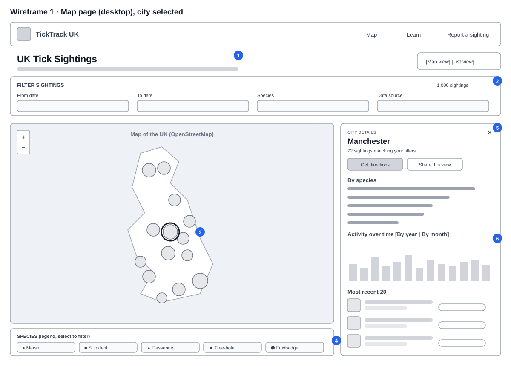
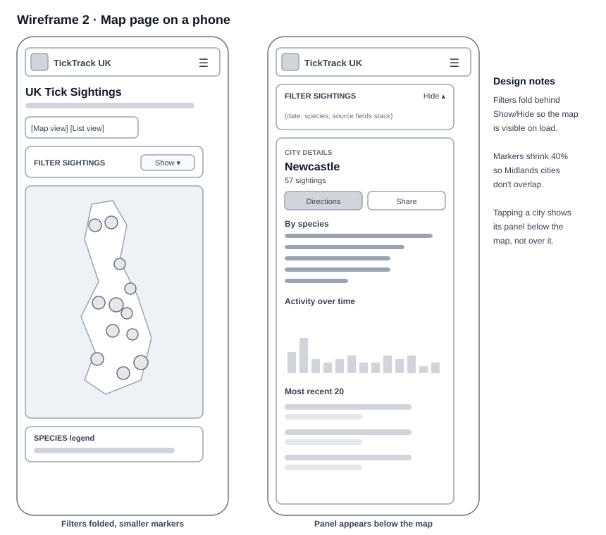
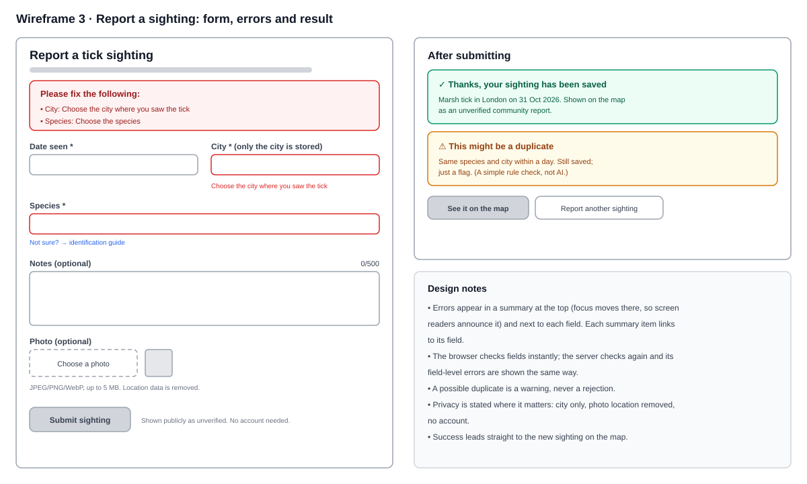

# Wireframes

Low-fidelity wireframes showing the layout and the user-experience decisions behind the main screens. They are deliberately grey and simple: they're about structure and flow, not visual design.

## 1. Map page (desktop), city selected

1. **Title and a Map/List switch at the top.** The list view is a full alternative to the map, for keyboard and screen-reader users and for anyone who prefers a table.
2. **Filters in one row above the map**, with the number of matching sightings, so people see the effect of a filter straight away. Filters are kept in the URL so a view can be shared.
3. **One marker per city**, sized by number of sightings and coloured by the most reported species. The data only gives a city, so plotting individual dots would suggest a precision it doesn't have.
4. **The legend doubles as a species filter**, and each species has its own shape as well as colour, so colour is never the only signal.
5. **Details open beside the map, not over it**, so the selected marker stays visible. The panel goes from summary to detail: total, species breakdown, timeline, then individual sightings.
6. **Timeline defaults to yearly totals.** At about half a sighting per city per month, a monthly chart would be mostly empty bars; monthly is one tap away.

## 2. Map page on a phone

- Filters fold behind a **Show/Hide** button, so the map is visible without scrolling.
- The map fits all 14 cities on any screen, and markers shrink so cities in the Midlands don't overlap.
- The city panel appears **below** the map rather than covering it.

## 3. Report a sighting

- **Errors in two places:** a summary at the top (which receives focus, so screen readers announce it, and whose items link to each field) and a message under each field.
- **The server always checks again**, and its field-level errors appear in the same way.
- **A possible duplicate is a warning, never a rejection**, and it is labelled as a simple rule, not AI.
- **Privacy is stated where the user makes the choice:** only the city is stored, photo location data is removed, and no account is needed.
- **Success leads straight to the new sighting on the map.**
